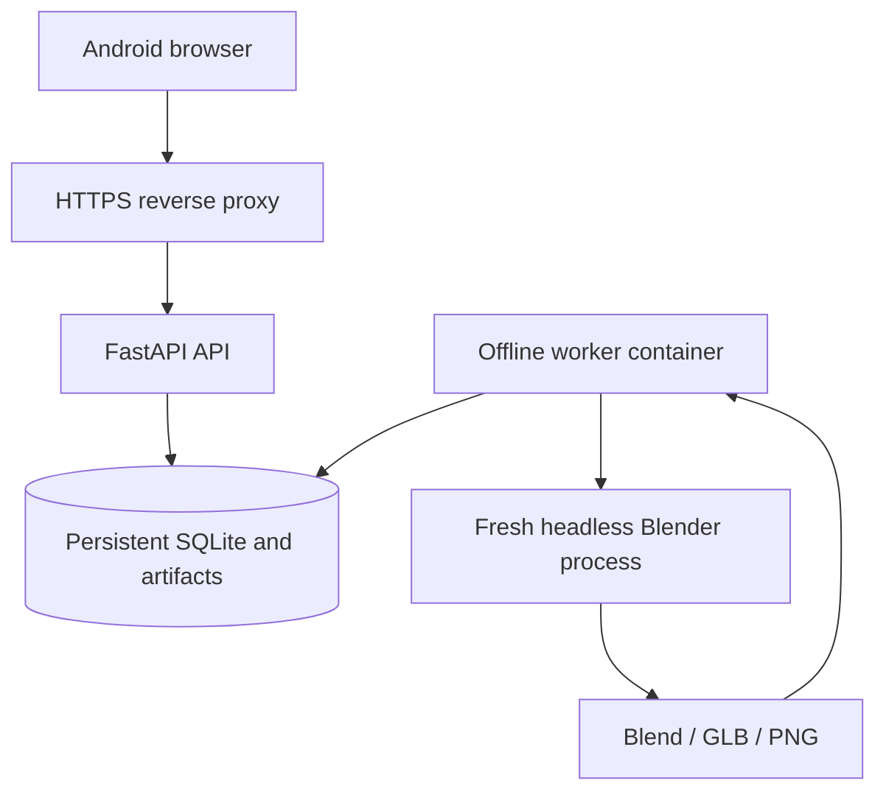

# Architecture and operational bounds

The phone talks only to the authenticated FastAPI control plane. The API validates scene JSON and records transactions in SQLite. A separate worker polls that database on the same host/local Docker volume; it has no network. Each claim gets an attempt token and fixed lease. The worker launches a fresh factory-startup Blender process for one snapshot, then atomically marks the job complete only if it still owns that claim.

## Boundaries

The API image has no Blender binary or Docker socket. The worker receives neither the API token nor LLM credentials, has no exposed port and uses `network_mode: none`. Both services run as UID/GID 10001 with a read-only root, dropped capabilities and no-new-privileges. A writable data volume and bounded `/tmp` are deliberate exceptions.

Blender itself receives a minimal environment, a validated JSON file, a fixed script path, and an output directory chosen by the worker. It starts with `--background --factory-startup --disable-autoexec --threads 2 --python-exit-code 1`. No uploaded `.blend`, arbitrary Python, filesystem path, remote asset URL, addon or MCP socket is accepted by the API. Cycles CPU at 12 samples generates a 640×480 PNG. The GLB contains meshes/materials/custom object IDs; camera and lighting stay in `.blend` and the PNG.

These are separate service containers sharing **one owner's database and artifact volume**. Each job gets a fresh process and directory, not a separate microVM/container or per-tenant mount. A compromised worker can access that workspace volume. Do not describe this as a hardened hostile multi-tenant sandbox. Rootless Docker/microVMs, per-owner volumes and a separate queue/artifact service would be needed before accepting untrusted assets or code.

## Persistence and state

- SQLite WAL, foreign keys, busy timeout and `BEGIN IMMEDIATE` for mutations. One host/local filesystem only; do not place SQLite on NFS/object storage or run replicas on separate hosts against separate volumes.
- Project edits require the expected revision. A chat proposal records its base revision and immutable proposed scene. Confirming atomically updates the project, queues its snapshot and records the job ID; duplicate confirmation returns that job.
- Project creation, chat submission and render submission retain request keys. Reusing a key with a different payload/version returns 409. Server state persists across restarts; sessionStorage holds only project ID and pending action, never credentials.
- Job states: queued → running → succeeded/failed; queued/running → cancelled. Running cancellation kills the process group at the next worker check. A deadline also kills/reaps the group and removes partial output.
- Expired leases become failed (`worker_lost`), with no automatic replay. Completion checks both lease and attempt, so obsolete workers cannot publish. Repeating a failed request key returns the same failure; an intentional retry uses a fresh key.
- A completed job publishes only three validated files with byte counts, SHA-256 and Blender version. Paths are constructed internally and symlink artifacts are refused. Downloads require the same authentication as projects.

## Limits and scope

| Resource | Current bound |
| --- | --- |
| Workspace identities | One owner/key; no separate user accounts |
| Projects / stored jobs / chat proposals | 100 / 500 / 2,000 per workspace |
| Simultaneously queued or running jobs | 8; one executing job per worker |
| Objects / primitive size / position | 24 / 0.1–20 m / −50–50 m per axis |
| Request body / message | 32 KiB streamed / 2,000 characters |
| Blender job / output / diagnostic log | 120 s default / 64 MiB per artifact / 4 MiB |
| Worker container | 2 CPU, 2 GiB RAM+swap ceiling, 128 PIDs, 512 MiB tmpfs |
| API container | 1 CPU, 512 MiB RAM, 128 PIDs, 64 MiB tmpfs |
| Storage admission | Reject new jobs after 2 GiB of recorded artifacts; worker requires 256 MiB free disk |
| Authenticated reads / writes / planning | 360 / 60 / 20 per minute, shared workspace |
| Login attempts | 5 per minute per observed client IP |
| Session | Signed HttpOnly cookie, SameSite=Strict, Secure by default, 12 h |
| Visible history | 50 latest jobs and 50 latest messages per project |

Storage admission uses recorded artifact bytes, not a strict filesystem quota; in-flight or interrupted work can exceed that accounting. There is no automated retention/garbage collection, deletion UI, rolling backup service, encrypted-at-rest store or cross-host object storage yet. Configure a host disk quota and operational backups before sustained use. Physical disk exhaustion cannot be solved by a SQLite counter.

Cookie mutations require the custom CSRF header and reject a mismatched Origin. There is no cross-origin browser API/CORS. Set the exact `PUBLIC_ORIGIN` behind HTTPS; proxy headers are not implicitly trusted. Cookies expire; rotating `API_TOKEN` invalidates all signed sessions. Logout clears the current browser cookie, not every previously issued session. The in-app key is a single-workspace access secret, not production organization identity management.

## External AI and MCP

Guided planning is local application logic and makes no network calls. The optional external planner is in the API only, behind an explicit spending gate, uses a fixed operator endpoint without redirects/retries, limits response bytes/tokens and validates the returned schema. It cannot render until a proposal is confirmed. Live model quality, provider billing and crash-safe exactly-once inference charges are outside the validated scope.

MCP-for-Blender is excluded from runtime: see the pinned source review in `MCP_INTEGRATION.md`. A future MCP facade should expose these bounded HTTP actions rather than arbitrary Blender Python.
